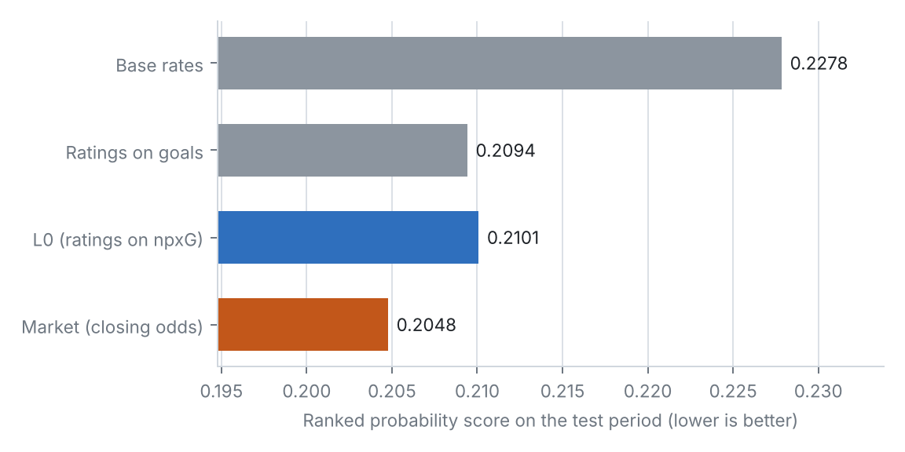

# Step 0 memo: Data v2 pipeline and baseline refresh

**Date:** 2026-10-16 · **Methodology:** v0.5 · **Code:** `opponent-aware-xi-dev` (`src/ingest.py`, `src/team_strength.py`, `src/run_l0.py`, `src/paper_analyses.py`, `src/step0_figures.py`)

## 1. In one paragraph

All four seasons of data (1,190 matches) now load into one clean set of tables, and every cross-check passes. The team-strength baseline (L0) was retuned on 2024/25 and tested on 2025/26 + 2026/27 (430 matches). It clearly beats the "know nothing" forecast (base rates) and sits a small but real step behind the bookmakers' closing odds: it closes about three-quarters of the gap between base rates and the market. Ratings keep about two-thirds of their strength from one season to the next. With three seasons, the case for chance quality (npxG) over results became statistically clear: a team's npxG in the first half of a season predicts its second-half points better than its first-half points do. You approved the split, the market as a reference only, and npxG as the target.

## 2. What was built

- **Data pipeline (`ingest.py`), rewritten for data v2.** Nine tables: matches (with formations, managers, possession), player-match stats, shots, passing-network nodes and edges, substitutions and red cards, closing odds (converted to probabilities), fixtures in all competitions (with rest days), and player attributes. No ID crosswalk is needed any more. All data checks run automatically and are saved in `data/processed/ingest_checks.json`.
- **Four source problems found and fixed:**
  - two players listed under old IDs in 2023/24 (four appearances and some shots);
  - the source's half-time scores leave out goals scored in first-half stoppage time (119 matches), so half-time scores are now rebuilt from the shots;
  - 52 substitutes who were later taken off themselves had the wrong entry minute, so it is now taken from the passing network;
  - 47 FA Cup fixtures appeared twice.
- **Evaluation harness (`run_l0.py`) for the new split:** warm-up 2023/24, tuning 2024/25, test 2025/26 + 2026/27. It now reports the market next to L0.
- **A new setting in L0: season carry-over.** Matches from earlier seasons get an extra discount on top of the normal "older counts less" decay, for summer transfers and manager changes.
- **Network analyses (`paper_analyses.py`)** rerun on three full seasons instead of one.
- **Figures** in `reports/figures/`: L0 vs market, calibration, season carry-over.

## 3. Decisions

| Decision | Options considered | Choice | Why |
|---|---|---|---|
| Split | Keep the old within-season split; or use whole seasons | Warm-up 2023/24, tuning 2024/25, test 2025/26 + 2026/27 (**approved**) | A full season to tune on; the test seasons are never used to choose anything |
| L0 settings | 216 combinations of memory length (half-life), pull toward average (ridge) and season discount (carry) | Half-life 540 days, ridge 4, carry 0.75 | Best at predicting next-match npxG on 2024/25. 30 combinations were effectively tied, and the tie-break was the best win/draw/loss score |
| How to discount past seasons (methodology's ω) | Shrink ratings toward average at each summer; or down-weight earlier seasons' matches | Down-weight earlier seasons (×0.75 per season back) | Same effect, simpler, and tunable on the same grid. Measured carry-over (ω = 0.68) agrees with it |
| Market's role | A bar each layer must clear; or a reference | Reference only (**approved**) | Bookmakers see team news and injuries; the fair bar for each layer is the layer before it |
| Target | npxG or goals | npxG (**approved**) | Better on the tuning season and for predicting next-match chances; ties with goals on results in the test |
| Market probabilities | Several ways to remove the bookmaker's margin | Divide each 1/odds by their sum | Simple and enough for a reference; the margin is about 5.5% |
| Half-time scores | Use the source's; rebuild from shots | Rebuild from shots | The source drops first-half stoppage-time goals |

## 4. Results

**L0 against the references (test: 430 matches).** Lower is better.

| Forecast | RPS | Log-loss |
|---|---|---|
| Base rates (league averages) | 0.2278 | 1.088 |
| Ratings fitted on goals | 0.2094 | 1.034 |
| **L0 (ratings fitted on npxG)** | **0.2101** | **1.036** |
| Market (Bet365 closing odds) | 0.2048 | 1.018 |

- **L0 vs base rates:** −0.018 (95% interval −0.027 to −0.009). A clear gain.
- **L0 vs market:** +0.005 behind (interval 0.000 to +0.011). L0 closes 77% of the gap between base rates and the market. On the tuning season, L0 was level with the market (0.1954 vs 0.1963).
- **L0 vs goals-based ratings:** a tie on results (difference +0.001, interval −0.003 to +0.005). npxG ratings were better on the tuning season (0.1955 vs 0.1988) and predict next-match npxG far better.
- **By season:** 2025/26 RPS 0.2110 (market 0.2046); 2026/27 R1–5 0.2027 (market 0.2058, only 50 matches).
- **Calibration:** good from 15% to 70%. The few very confident forecasts (above 70%, 7 cases) came in lower than predicted, too few to judge. Draws are slightly under-predicted (25% predicted, 28% observed).
- **Fitted values:** home advantage ×1.18 on chances; xG-to-goals factor 1.00–1.02; Dixon–Coles draw correction −0.09 to −0.01.
- **Season carry-over (ω):** 0.68 (interval 0.50 to 0.91). A team rated +0.30 npxG per match this season is expected at about +0.20 next season.
- **Current ratings (after 2026/27 R5):** Arsenal, Manchester City, Liverpool, Chelsea and Brighton top; the promoted Hull, Coventry and Ipswich bottom.

**Chance quality vs results (60 team-seasons, first half of season → second half).** Correlation with second-half points per match:
- npxG difference 0.78;
- expected points 0.78;
- points 0.69;
- goal difference 0.69.

npxG minus points: +0.09 (interval +0.01 to +0.18). With one season this was unresolved; with three, npxG is clearly the better predictor.

**Passing-network metrics (three seasons, 2,280 team-matches):**
- **Reliability:** 14 of 15 metrics above 0.80 as season-long team traits; forward-pass share is the exception at 0.67.
- **After removing possession:** 14 of 15 still above 0.74.
- **Team vs opponent:** the opponent shapes the numbers almost as much as the team does. For defensive line height, team explains 23% of match-to-match variation and opponent 20%.
- **Season-to-season stability:** high for line heights (0.90), attacking height (0.91), pass volume (0.87) and pass entropy (0.88). Low for width (0.50) and flank share (0.36).

## 5. What it means for the model

- **The bar is set.** Every later layer has to beat L0's 0.2101 on the same 430 test matches, by the same paired comparison. Matching the market would mean recovering most of the remaining 0.005, the part that comes from knowing who plays. That is exactly what L1 (lineups) adds.
- **Use enough history.** The best memory is long (half-life about 18 months), with a modest summer discount. Steps 1–3 should expect the same: team style and player profiles need more than a few recent matches.
- **Style is real and opponent-shaped.** The network metrics are stable team traits, but opponents move them almost as much as the team does. That confirms Step 1's plan to split each team's style into its own style and the style its opponents impose. Width and flank use change a lot between seasons, so they should get shorter memories than line height.
- **npxG stays the target** for the player and matchup layers.

## 6. Questions for Benjamin (checkpoint), answered 2026-10-16

1. Approve the split (warm-up 2023/24, tuning 2024/25, test 2025/26 + 2026/27)? **Approved.**
2. Treat the market as a reference only, with each layer judged against the one before it? **Approved.**
3. Keep npxG as the target despite the tie with goals on results? **Approved.**

## 7. Next step

**Step 1: Team style from passing networks** (methodology §5.1–5.5, §6):
- shape and structure metrics for every team-match;
- formations inferred from the networks;
- each team's own style separated from what opponents impose;
- a few named style dimensions.

The checkpoint will ask whether the inferred formations look right for matches you know, and whether the style dimensions have sensible names.
