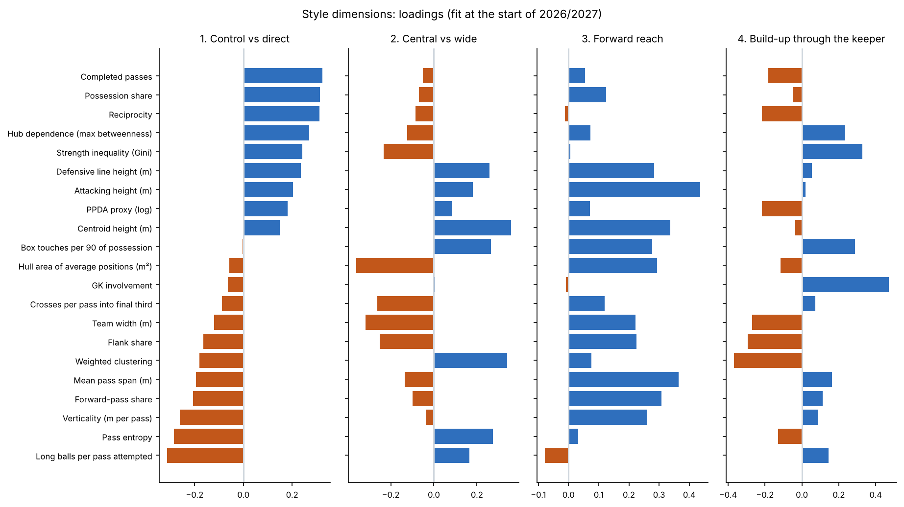
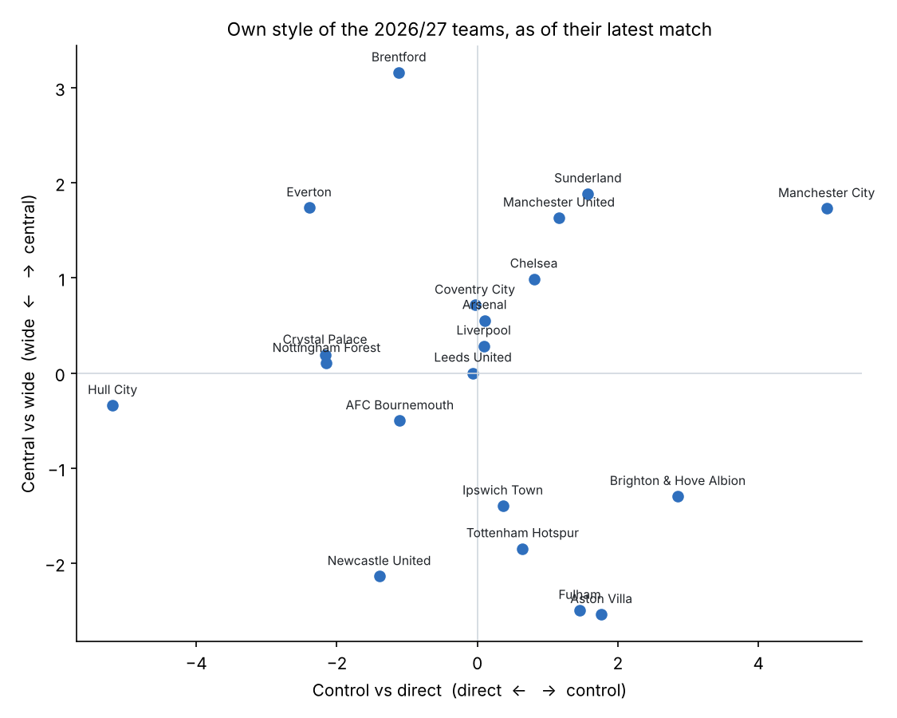
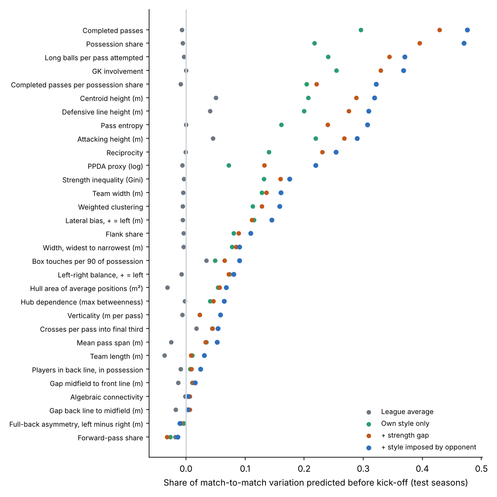

# Step 1 memo: Team style from passing networks

**Date:** 2026-10-18 · **Methodology:** v0.6 · **Code:** `opponent-aware-xi-dev` (`src/network.py`, `src/style.py`, `src/step1_figures.py`, `tests/test_step1.py`)

## 1. In one paragraph

Every team-match (2,380) now has 31 style measurements taken from its passing network and box score, and each starter has a slot in his team's formation. For every match date, each team's style is split into what it does itself and what its opponents force on it, using only earlier matches. Knowing the opponent clearly improves the pre-match forecast of how a team will play. Part of that is simply the opponent's strength. The rest is the opponent's own imposed style, which helps on its own for 19 of 31 measurements on the test seasons and makes none clearly worse. Teams' own styles boil down to four dimensions that you named: **control vs direct**, **central vs wide**, **forward reach** and **build-up through the keeper**. You also confirmed that the formations look right.

## 2. What was built

- **Style measurements for every team-match (`network.py`).** There are 31 of them:
  - **shape**, from where the ten outfield starters stood on average: how high the team sits, how high its back line is, its length, width and compactness, and its left/right lean;
  - **structure**, from who passed to whom: how evenly the ball is spread, how much it goes through one player, how much is back-and-forth combination play, how forward and how wide passing goes, and how much the keeper is involved;
  - **team habits**: possession, pressing, box entries, crossing and long balls.
- **Slots.** Each starter is placed in a slot of his team's teamsheet formation (left-back, holding midfielder, striker and so on) by the best one-to-one match between where players stood and where the formation's slots sit.
- **Lines in possession.** The shape the team actually takes on the ball, read from the data as lines from back to front. For example, Liverpool in a 4-2-3-1 often shows as 2-5-3, with the full-backs pushed up.
- **Own style vs imposed style (`style.py`).** For each measurement and each match date, a model fitted on earlier matches only separates:
  - the team's own style;
  - what its opponent imposes on its opponents;
  - home advantage, the score during the match, and the strength gap between the two teams.
- **Style dimensions.** The 21 measurements with a real team signal are combined into four style dimensions. These are refitted at the start of each season from earlier seasons only.
- **Tables:**
  - `data/processed/team_match_network.parquet`: one row per team-match;
  - `data/processed/player_slots.parquet`: one row per outfield starter;
  - `data/processed/team_style_asof.parquet`: own style, imposed style and style dimensions for both teams, as of every match;
  - `data/processed/team_ratings_asof.parquet`: the team-strength ratings as of every match date.
- **Tests** (`tests/test_step1.py`) check the slot assignment, the line detection and the game-state shares. They also check that fitting style for a date doesn't depend on any later match: scrambling every later match changes nothing.

## 3. Decisions

| Decision | Options considered | Choice | Why |
|---|---|---|---|
| Which formation slots come from | The formation that best fits the network; or the teamsheet formation | **Teamsheet formation**, players matched to its slots | The best-fit version kept reading a holding midfielder dropping between the centre-backs as a back five. Checked against the source's position labels, the teamsheet version is right more often: 85% vs 82% overall, and 92% vs 60% for holding midfielders. The shape on the ball is kept separately as style (next row) |
| Shape in possession | A named formation from the template library; or lines found in the data | **Lines found in the data** (best split into 3 or 4 lines by depth) | Teams on the ball rarely look like a named formation: half of back fours show only two players in the last line |
| Defensive line height | Mean depth of the detected back line; or of the four deepest outfielders | **Four deepest outfielders** | The detected back line is often just the two centre-backs, which would make line height jump between matches for reasons that aren't style |
| Pass links | Match totals; or per 90 minutes of shared time on the pitch (as the methodology said) | **Match totals** | Per-90 links let a substitute with two passes in three minutes look like a key link. On 2023/24–2024/25 that cut the team signal for pass inequality from 0.92 to 0.34 and for clustering from 0.90 to 0.11 |
| How own and imposed style are estimated | Full mixed model; or ridge regression with tuned pull toward average | **Ridge regression**, memory length and pull toward average chosen per measurement on 2024/25 | Gives the same kind of answer (each team pulled toward average in proportion to how little evidence there is) and is fast enough to refit before all 360 match dates |
| Which measurements enter the style dimensions | All 31; or those with a real team signal | **21**: duplicates and left/right measures removed, plus four with no detectable team signal on 2024/25 (the two line gaps, players in the back line, algebraic connectivity) | Mirrors the methodology's rule for player stats: a stat with no between-team signal is dropped |
| Number of style dimensions | 4 to 6 | **4** (74% of the variation between teams) | Smallest number that reaches 70%, decided on the fit built from 2023/24 and 2024/25 only |
| Names of the dimensions | — | Control vs direct; central vs wide; forward reach; build-up through the keeper (**approved**) | From what each dimension is made of (figure below) and which teams sit at each end |

## 4. Results

**Slots.** Where the source has a position label (16,145 starters), the slot agrees with it on role 85% of the time and on side of the pitch 91% of the time:

| Role | Agreement |
|---|---|
| Centre-backs | 92–93% |
| Holding midfielders | 92% |
| Full-backs | 90–91% |
| Wingers | 83–84% |
| Central midfielders | 82% |
| Strikers | 72% |
| Attacking midfielders | 70% |

The misses are mostly forwards who swap places during a match. Slots are about where a player stood, not his job; Step 2's roles cover the job.

**Lines in possession.** Back fours show only two players in the last line in 57% of matches (full-backs pushed up). Back threes keep three in 46%.

**How much of a team's style is predictable before kick-off** (test seasons, 860 team-matches; share of match-to-match variation explained):

| Measurement | Own style only | + strength gap | + opponent's imposed style |
|---|---|---|---|
| Possession | 22% | 40% | **47%** |
| Completed passes | 30% | 43% | **48%** |
| Passes per unit of possession | 20% | 22% | **32%** |
| Pass entropy (how evenly spread) | 16% | 24% | **31%** |
| Defensive line height | 20% | 28% | **31%** |
| Pressing (PPDA proxy) | 7% | 13% | **22%** |
| Average over all 31 | 10% | 14% | **16%** |

- **Knowing the opponent** (strength and imposed style together) helps for 20 of 31 measurements, with intervals above zero.
- **The imposed style on its own**, beyond the strength gap, helps for 19 of 31 and clearly hurts none. The clearest cases are tempo, pressing, possession and pass entropy.
- An example from before Man City 3–0 Liverpool: teams facing City end up with their back line about 0.9 m deeper than their own style and strength would predict.

**Memory length.** The best memory differs by measurement, as Step 0 suggested:

- **60 days:** possession, pass volume, width, how high the team sits.
- **120 days:** line heights, pressing, keeper involvement.
- **No decay:** shape proportions such as compactness and forward-pass share. These are steady traits measured with a lot of noise, so they need all the evidence.

**Style dimensions** (fit at the start of 2026/27 on 60 team-seasons):

| Dimension | Share of variation | Made of | High end | Low end | Stability between seasons |
|---|---|---|---|---|---|
| 1. Control vs direct | 37% | possession, passes, combination play, high lines vs long balls and vertical passing | Man City, Brighton | Hull, Everton, Palace | 0.85–0.88 |
| 2. Central vs wide | 17% | clustering, central and high positions vs width, flank play and crossing | Brentford, Sunderland, Everton | Villa, Fulham, Newcastle | 0.66–0.77 |
| 3. Forward reach | 11% | high front line, long and forward passes | Hull, Spurs, Fulham | Palace, Brentford, Leeds | 0.45–0.79 |
| 4. Build-up through the keeper | 9% | keeper involvement, play through one or two hubs | Brighton, Leeds, Brentford | Man City, Man United | 0.67–0.72 |

Six example matches with slots and lines are in `reports/figures/formations_*.png`.

## 5. What it means for the model

- **The opponent-aware idea passes its first test.** Who you play changes how you play, beyond how strong they are, and that is predictable before kick-off. This is about style, not yet results. Step 4 tests whether style clashes move chances (npxG) and points.
- **Step 2 can now use network positions.** Every starter has a slot in every match, which fills the 7,655 starters with no position label. Each player also has his average position relative to his team, ready for role discovery.
- **Step 4 has its inputs ready.** The four style dimensions are the inputs for the style-clash term (L2). The imposed-style table is the opponent side of the matchups.
- **A scouting output exists already.** "What a team does to its opponents" is now a table for every team and match date, as the findings log suggested.

## 6. Questions for Benjamin (checkpoint), answered 2026-10-18

1. Do the inferred formations look right for matches you know? **Yes.**
2. Do the four style dimensions have sensible names? **Yes**, as proposed.

## 7. Next step

**Step 2: Player profiles and roles** (methodology §4):

- per-90 rates pulled toward the average for players with few minutes, adjusted for possession and opponent;
- recent matches weighted more heavily;
- roles found by clustering, using the slots and network positions from this step.

The checkpoint will ask whether the roles look like real football roles, and for a spot-check of five players you know well.
