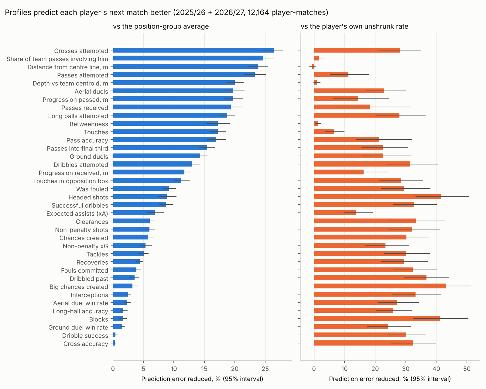
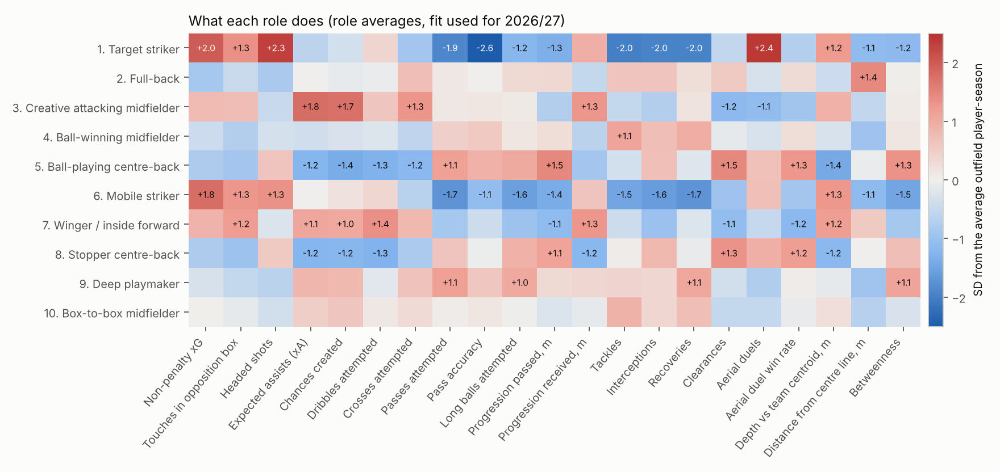
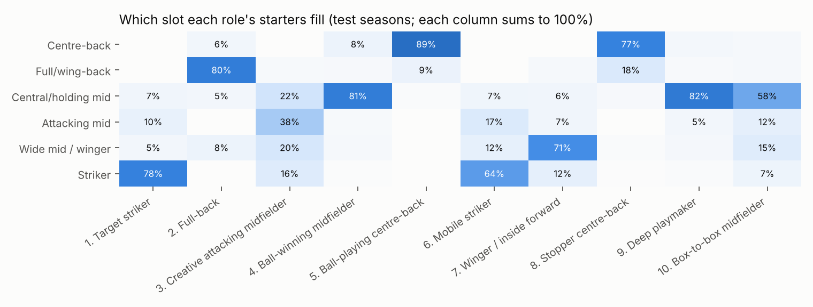

# Step 2 memo: Player profiles and roles

**Date:** 2026-10-19 · **Methodology:** v0.7 · **Code:** `opponent-aware-xi-dev` (`src/profiles.py`, `src/roles.py`, `src/step2_figures.py`, `tests/test_step2.py`)

## 1. In one paragraph

Every outfield player in every matchday squad (43,392 player-matches) now has a profile of 38 measurements as of the match date: shooting, creation, passing, defending, duels, and where he plays and how central he is in his team's passing network. Each measurement is a rate per 90 (or a success rate), adjusted for his team's possession and for the opponent, weighted toward recent matches, and pulled toward his position group's average by an amount that depends on how much evidence there is. On the test seasons these profiles predict each player's next match better than his position group's average for all 38 measurements, and better than his own unadjusted rate for 35 of 38 (the other three tie). From the profiles, ten roles were found by clustering. You confirmed that the names are right and that the roles look right for players you know. Every squad player now has a probability for each role as of every match from 2024/25 on.

## 2. What was built

- **Profiles (`profiles.py`).** For each of the 38 measurements, the code walks through the 360 match days in order and keeps, for every player, a running total of what he did and of how much he played, with older matches counting less. Before each day's matches, every squad player's profile is read off those totals, so a profile only ever uses earlier matches.
- **Pull toward the group average (shrinkage).** A player with three matches and two goals doesn't really score 0.67 per 90. His rate is pulled toward his position group's average (centre-back, full-back, central midfielder, attacking midfielder, winger, striker), less and less as his minutes add up. How hard to pull is estimated from the data for each measurement and group, from two quantities: how much players genuinely differ, and how much one player varies from match to match. Examples of the evidence needed before a player's own rate counts as much as the group average:
  - **npxG:** about 7 matches for attacking midfielders, 34 for strikers, over 100 for centre-backs (centre-backs' shooting is mostly noise).
  - **Passes:** 2 to 4 matches.
  - **Pass accuracy:** 90 to 150 passes.
- **Adjustments for context.** Counts are adjusted for the team's possession (defenders on a team without the ball have more chances to tackle) and for the opponent (ten box touches against a team that concedes plenty count for less). Each opponent's "allowance" is itself estimated as of the date and pulled toward average.
- **Passing-network measurements per player.** From the Step 1 networks: passes received, metres of progression passed and received, average depth relative to his team, distance from the centre line, betweenness (how often play runs through him), and share of the team's passes involving him.
- **Roles (`roles.py`).** Each player-season with at least 900 minutes is described by 29 of the measurements. A mixture model groups them into ten roles. The roles are refitted at the start of each season from earlier seasons only, starting from the previous season's roles so each one keeps its meaning. Every squad player gets a probability for each role, using his profile as of that match.
- **Tables:**
  - `data/processed/player_profile_asof.parquet`: one row per outfield squad member per match, with all 38 measurements and his position group;
  - `data/processed/player_roles_asof.parquet`: the ten role probabilities for the same rows from 2024/25 on (2023/24 has no earlier season to learn roles from);
  - `data/processed/player_match_network.parquet`: the network measurements per player-match.
- **Tests** (`tests/test_step2.py`):
  - the shrinkage recovers known values on simulated players;
  - scrambling every match after 1 December 2024 leaves every profile up to that date unchanged;
  - role fits use earlier seasons only, and each player's role probabilities add up to 1.

## 3. Decisions

| Decision | Options considered | Choice | Why |
|---|---|---|---|
| How to pull rates toward the average | Three separate statistical models (one each for counts, success rates and averages), fitted by maximum likelihood, as the methodology said; or one rule for all three | **One rule** (credibility weighting) | It gives exactly the textbook answer for each of the three kinds, is fast enough to recompute before all 360 match days, and allows for counts that vary more than pure chance would (tackles vary about 1.8× more) |
| Groups for the average | Source position labels; slots from Step 1; roles | **Six position groups from the Step 1 slots**, taken from where each player has mostly started recently | Labels are missing for 29% of starters. Roles are found from the profiles themselves and don't exist for 2023/24, so they can't be the starting point. Players who have never started use the all-outfield average |
| How memory is measured | Number of the team's matches (methodology); or days | **Days**, with a separate weight for earlier seasons, as for teams | The same scale as the team models; the grid ran from 60 days to no decay |
| Possession adjustment | Full adjustment for every count (methodology); or let the data choose how strong | **Strength chosen per measurement** on 2024/25: full, half or none | The full adjustment over-corrects for some measurements. Half strength wins for tackles, interceptions and dribbled past; none for recoveries, fouls and long balls; full for the rest |
| Opponent adjustment | Per role (methodology); or per position group | **Per position group** | Roles come from the adjusted profiles, so adjusting by role would be circular. Kept for 26 of 27 counts; box touches is better without it |
| Substitute minutes | Count half (methodology's starting point); or full | **Full**, chosen on 2024/25 | Half weight made predictions worse for 37 of 38 measurements; the 38th was a tie |
| Line-breaking passes | Keep or drop | **Dropped** | Zero in every 2023/24 and 2024/25 row (not collected then), and their average jumps 1.7× between 2025/26 and 2026/27 (definition change) |
| Role inputs | Each player-match; or one row per player-season | **Player-season, at least 900 minutes**, taken from his profile at the end of the season | About 300 well-measured players per season; short spells would add noise |
| Role model | Mixture with a separate spread per role; or one spread shared by all roles | **Shared spread**, after reducing 29 measurements to 8 combined ones (93% of the variation) | Separate spreads mean too many numbers for 300–900 rows, and the model then prefers only 4–5 coarse roles. With a shared spread, roles differ in their average profile |
| Number of roles | 6 to 14 | **10** (approved) | The statistical fit (BIC) is best at 12 but almost flat from 10 to 12. Among 9–12, ten is the most stable when 2024/25 is split in halves, and every role reads as a recognisable football role |
| Keeping roles consistent across seasons | Refit from scratch and match roles afterwards; or start each refit from last season's roles | **Start from last season's roles** | Refitting from scratch changed what roles meant (two centre-back roles merged in one refit). Starting from last season's roles keeps all ten; their averages move only 0.4–0.5 standard deviations between refits |
| Role names | — | Proposed from what each role does and who is in it (**approved**) | See the figure and table below |

## 4. Results

**Profiles predict the next match better** (test seasons 2025/26 + 2026/27, 12,164 player-matches; error reduction with 95% intervals from resampling matches):

| Compared with | Better on | Median gain | Examples |
|---|---|---|---|
| The position group's average | **38 of 38** | 9% | crosses 26%, passes 23%, aerial duels 20%, npxG 5%, tackles 5% |
| His own unadjusted rate (no pull toward the average) | **35 of 38**, 3 ties | 28% | headed shots 42%, blocks 41%, npxG 23%, passes 11% |
| The same profile without possession and opponent adjustments | **22 of 27** adjusted counts, none worse | — | passes 34%, passes received 35%, progression passed 15%, final-third passes 7% |

The three ties with the unadjusted rate are average positions (depth, distance from the centre line, side). These are steady for a player and measured precisely, so there is little to gain by pulling them toward the group.

**Memory length.** As for teams, it differs a lot by measurement:

- **No decay:** shooting, creation and most defending (npxG, shots, xA, chances created, dribbles, tackles, interceptions, blocks, duels). These are steady traits measured with a lot of noise, so they need all the evidence.
- **One to two years, with earlier seasons counting half:** passing volume (passes, touches, crosses, long balls, progression). This is partly the team's style, which changes when managers and teammates change.
- **Two to twelve months:** where a player plays (depth 365 days, distance from the centre line 120, side 60). Positions change when a manager moves a player.

**No detectable difference between players** within a position group, so everyone gets the group average:

- cross accuracy in 62% of profiles;
- long-ball accuracy in 15%;
- dribble success in 7%;
- 3% across all measurements.

Success rates on low-volume actions are mostly noise at this sample size.

**Ten roles** (fit used for 2026/27; share = share of player-seasons):

| # | Role | Share | What sets it apart | Typical players |
|---|---|---|---|---|
| 1 | Target striker | 4% | aerial duels, headed shots, npxG; few passes | Wood, Morris, Calvert-Lewin, Strand Larsen, Delap |
| 2 | Full-back | 19% | far from the centre line, crosses, balanced defending | Kerkez, Robinson, Truffert, Muñoz, Porro |
| 3 | Creative attacking midfielder | 4% | xA, chances created, crosses, progression received | Palmer, Ødegaard, Bruno Fernandes, Gibbs-White, Foden |
| 4 | Ball-winning midfielder | 13% | tackles and recoveries, central, steady passing | Caicedo, Gravenberch, Gueye, Zubimendi, João Gomes |
| 5 | Ball-playing centre-back | 17% | deepest, most progression passed, high pass accuracy | Saliba, Van Dijk, Collins, Kilman, Milenković |
| 6 | Mobile striker | 7% | npxG and box touches, half the aerial duels of role 1 | Haaland, Watkins, Isak, Solanke, Wissa |
| 7 | Winger / inside forward | 19% | dribbles, box touches, wide and high | Salah, Saka, Mbeumo, Semenyo, Rogers |
| 8 | Stopper centre-back | 5% | clearances and aerial duels, more long balls, fewer passes | Tarkowski, Andersen, Murillo, Branthwaite, Lacroix |
| 9 | Deep playmaker | 5% | most passes, high betweenness, progression received | Bruno Guimarães, Enzo Fernández, Gross, Anderson, Rice (2025/26) |
| 10 | Box-to-box midfielder | 7% | a bit of everything, higher up than role 4 | McGinn, Gallagher, Le Fée, Hamer, Christie |

**Roles agree with slots without being slots.** On the test seasons:

- 77–89% of each defensive role's starters fill the matching slot (centre-back or full-back);
- about 80% for the two holding roles;
- about 70% for wingers;
- 64–78% for the two striker roles.

The creative attacking midfielder is spread over attacking-midfield (38%), central (22%), wide (20%) and striker (16%) slots, which is what a free role looks like. Roles describe what a player does; slots describe where he stood.

**Stability.**

- **Season to season:** 85% of players keep their top role from one season to the next.
- **Within a season:** fitting each half of a season separately, 65% (2024/25) and 53% (2025/26) keep their role. That is a stricter test: each half uses only half a season of unadjusted data.
- **Probabilities:** most players sit clearly in one role (median top-role probability 0.99). 5% of profiles have a top role below 0.6, for example Bruno Guimarães (deep playmaker 0.79, box-to-box 0.20) and Tarkowski (ball-playing 0.72, stopper 0.28).

**Spot check** (approved): Saka, Salah and Rogers are wingers / inside forwards; Haaland and Isak mobile strikers; Chris Wood a target striker; Palmer, Ødegaard and Bruno Fernandes creative attacking midfielders; Caicedo a ball-winning midfielder; Rice and Bruno Guimarães deep playmakers; Van Dijk and Saliba ball-playing centre-backs; Porro a full-back. The full table is `reports/role_spotcheck.csv`.

## 5. What it means for the model

- **Step 3 has its starting point.** The player-effects model rates each player from the xG his team creates and concedes while he is on the pitch, starting from a prior built from his profile. A player with few minutes is rated mostly by his profile, so better profiles mean better ratings for fringe players, which is exactly where lineup choices are made.
- **The optimiser can use roles.** Role probabilities say which slots a player can fill (methodology §13.1) and how far out of position a choice would be.
- **The matchup layer has its inputs** (Step 4):
  - dribbles and dribbled past, and aerial win rates, for the duel features;
  - each opponent's allowance by position group ("opposing wingers get 30% more box touches against this team"), ready for the zone features and the explanations.
- **One caveat for Step 3.** The role probabilities are very confident (median 0.99). That comes from the model, and it shouldn't be read as real certainty about a player's role. If the next layers need softer memberships, they can be softened, with the amount tuned on 2024/25.
- **Not done yet.** The methodology suggests recomputing the group averages by role once roles exist. That would need roles in 2023/24, which has no earlier season to learn them from, and it was not tested. Position groups stay the basis for now.

## 6. Questions for Benjamin (checkpoint), answered 2026-10-19

1. Do the ten roles look like real football roles, and are the names right? **Yes**, ten roles with the proposed names.
2. Do the roles look right for players you know? **Yes.**

## 7. Next step

**Step 3: Stints and the player-effects model (L1)** (methodology §3, §8, §9 without the style and matchup terms):

- cut every match into stints, the stretches when the same 22 players are on the pitch;
- fit each player's attacking and defensive effect, starting from his profile;
- add the goalkeeper's shot-stopping prior;
- test whether L1 beats the team-strength baseline (L0) on the test seasons.

The checkpoint will ask whether the top- and bottom-rated players make football sense.
