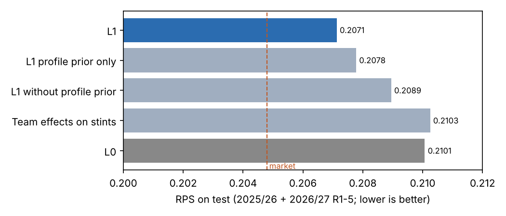
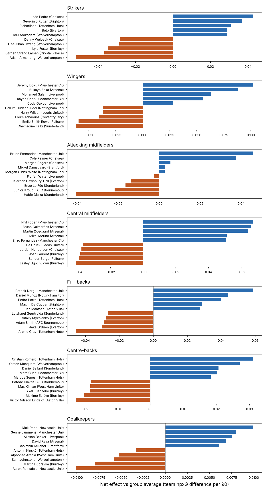

# Step 3 memo: Stints and the player-effects model (L1)

**Date:** 2026-10-19 · **Methodology:** v0.8 · **Code:** `opponent-aware-xi-dev` (`src/stints.py`, `src/outcome.py`, `src/run_l1.py`, `src/gk.py`, `src/step3_figures.py`, `tests/test_step3.py`)

## 1. In one paragraph

Every match is now cut into stints: stretches in which the same 22 players are on the pitch and the score doesn't change (11,454 stints, about 10 per match). On those stints the model learns how much each player adds to his team's chances (npxG) and takes away from the opponent's. Each player starts from what his box-score profile from Step 2 says, and moves away from it only as far as his own on-pitch record justifies. Before a match, the model adds up the effects of the eleven starters (and the likely substitutes) to forecast each side's npxG, then turns that into win, draw and loss chances exactly as L0 does. **L1 beats L0 on the test seasons**: ranked probability score 0.2071 against 0.2101 (95% interval of the difference −0.0048 to −0.0011). It now gets 90% of the way from base rates to the betting market, up from 77%. Almost all of the gain comes from knowing who starts and what those players do in the box score. Each player's own plus-minus adds very little: football has too few goals, and teammates play together too much, for it to separate players well. The goalkeeper's shot-stopping was estimated but did not improve forecasts, so it is not used.

## 2. What was built

- **Stints (`stints.py`).** For every match, a clock with stoppage time included (matches average 100 minutes), every player's entry and exit time, every goal, and every red card. A new stint starts whenever any of these changes. For each stint and each side the table records:
  - its length;
  - who was on the pitch;
  - the score difference and the man count;
  - the npxG created, split into open play and set pieces.
  
  **Checks:** every shot lands in exactly one stint; each side's stint npxG adds up to its match npxG in all 2,380 team-matches; the stints cover every minute; 97.5% of minutes have eleven players a side, and the rest are red cards.
- **Player-effects model (`outcome.py`).** For each stint, the npxG a side creates depends on:
  - the league level, home advantage, the score difference and the man count;
  - a team effect for each side (the system and the coaching);
  - an attacking effect for each of its players on the pitch, minus a defensive effect for each opposing player.
  
  Each player's effect has two parts: what his profile predicts (the **box-score prior**) and a personal deviation learned from his on-pitch record. Every part is held toward zero (**regularised**) by an amount chosen on 2024/25. The model is refitted before every match day from earlier matches only.
- **Pre-match forecast.**
  - Each starter counts for his usual share of a match (about 85% for an outfield player, from his earlier starts), and the rest of his share goes to his team's average substitute.
  - The score is unknown before kick-off, so it is set to its average effect.
  - The rate is scaled to a full match of about 100 minutes.
  - A level check keeps forecasts on the league's current scoring level: actual npxG over predicted for the previous 120 days.
- **Goalkeeper shot-stopping (`gk.py`).** Goals conceded against the quality of on-target shots faced (xGOT), for every keeper, as of every match, pulled hard toward average.
- **Tables:**
  - `data/processed/stints.parquet` (one row per stint per side);
  - `data/processed/stint_players.parquet` (who was on the pitch);
  - `data/processed/player_times.parquet` (entry and exit times);
  - `data/processed/gk_asof.parquet` (keeper ratings as of every match);
  - `data/processed/l1_predictions.parquet` (L1's forecast for every test match).
- **Tests** (`tests/test_step3.py`):
  - stints reconcile with shots and with the match clock;
  - each goal ends its stint;
  - scrambling every later result leaves a fit unchanged;
  - keeper ratings use earlier shots only and are pulled toward average;
  - the pull toward average beats raw ratios on simulated keepers.

**Terms.** *Box score:* a player's stat line for one match (shots, passes, tackles…). *Profile:* his box scores turned into adjusted per-90 rates (Step 2). *Plus-minus:* crediting a player with what his team creates and concedes while he is on the pitch, controlling for everyone else on it.

## 3. Decisions

| Decision | Options considered | Choice | Why |
|---|---|---|---|
| Fitting method | Full Bayesian sampling; or the most likely values under the same priors (ridge penalties) | **Ridge penalties** (the methodology's "faster first version") | Refitting before every match day takes seconds; sampling would take hours per fit |
| Substitution times | Minutes played only; or the passing network's substitution minutes | **Network minutes where they exist** (2023/24–2025/26) | The minutes-played column caps at 90, so players taken off in stoppage time looked as if they stayed on, and about 40 team-matches showed 12–14 players on the pitch at the end. With network minutes, 3 short stints out of 22,908 remain |
| How strongly to pull each part toward zero | A grid on 2024/25 (team effects, personal deviations, box-score prior; full 37 measurements or a compact 14) | **Team 4, personal deviation 300, box-score 10,000, all 37 measurements** | Lowest forecast error on 2024/25 (settings within 0.5% tie; lowest RPS among them). In plain terms: a player's own record can move him only about ±4%; most of his rating comes from his profile |
| Standardizing profiles | Over all outfield players; or within position group | **Over all outfield players** | Within-group made forecasts worse: it hides real differences between positions from the box-score prior |
| Match length | Per 90 minutes; or per actual match length | **Scaled to the average match length (about 100 minutes)** | Found while testing: without it L1 forecast 11% too little npxG |
| Level check | None; or actual over predicted for recent matches | **Previous 120 days**, as of each date | The fit's average level lagged changes in league scoring between seasons (forecasts were 6% too high on 2024/25); L0 has the same kind of correction for goals |
| Goalkeeper factor | Use the shot-stopping rating on goals conceded; or leave it out | **Left out** | It made 2024/25 forecasts worse (RPS 0.1955 vs 0.1939). The model forecasts npxG, which a keeper can't change, and the effect on goals is small and noisy |
| How to show ratings | Across all players; or within position group | **Within position group** | Every lineup has about the same number of defenders, midfielders and forwards, so the model can't tell positions apart well, and defenders who come on to protect a lead pick up negative effects. Within a group the comparison is fair |

## 4. Results

**L1 against L0 on the test seasons** (2025/26 + 2026/27 R1–5, 430 matches; differences with 95% intervals from resampling matches):

| Model | RPS | Log-loss | npxG error |
|---|---|---|---|
| Base rates | 0.2278 | — | — |
| L0: team ratings | 0.2101 | 1.036 | 0.359 |
| Team effects on stints, no players | 0.2103 | 1.037 | 0.359 |
| Players without the box-score prior | 0.2089 | 1.033 | 0.359 |
| Players with the box-score prior only | 0.2078 | 1.029 | 0.357 |
| **L1** | **0.2071** | **1.027** | **0.355** |
| Market (Bet365 closing; reference) | 0.2048 | — | — |

- **L1 − L0:** RPS −0.0029 (−0.0048 to −0.0011); log-loss −0.0085 (−0.0141 to −0.0027); npxG error −0.0035 (−0.0111 to +0.0038, not significant).
- **Where the gain comes from:** stints on their own add nothing (they tie L0). Each player's personal deviation adds −0.0006 on top of the box-score prior, which is not significant. The gain is knowing who starts and what they do.
- **By season:** 2025/26 RPS 0.2077 vs 0.2110; 2026/27 R1–5 0.2025 vs 0.2027, a tie (50 matches).

**Why personal plus-minus is mostly noise.** A good player changes his team's npxG by perhaps 0.05–0.10 per match; match-to-match npxG varies about ten times that, and teammates mostly play together. As a rough estimate, telling a player apart on his own record would take several hundred full matches. Regulars here have well under a hundred. The tuning found this by itself: for a regular with about 60 matches, his own record gets roughly a tenth of the weight and his profile the rest.

**Player ratings within position group** (as of the end of the data; 900+ minutes in the previous year; net = npxG difference per 90 against the group average). Top of each group:

- **Strikers:** João Pedro, Rutter, Richarlison (Haaland 6th of 37)
- **Wingers:** Doku, Saka, Salah, Cherki
- **Attacking midfielders:** Bruno Fernandes, Palmer
- **Central midfielders:** Foden, Bruno Guimarães, Ødegaard, Merino, Enzo Fernández
- **Full-backs:** Dorgu, Muñoz, Porro
- **Centre-backs:** Romero, Mosquera, Guéhi
- **Goalkeepers:** Pope, Lammens, Alisson, Raya (small differences: keepers barely move npxG)

The bottom of most groups is mainly players from weaker sides (Burnley, Sunderland, Wolves). The full table is `reports/player_ratings_by_group.csv`.

**Goalkeepers (shot-stopping, not used in forecasts).** A keeper's own record counts as much as the league average only after about 80–170 expected goals on target faced, more than a season. On the latest data the best shot-stoppers are Pickford, Donnarumma and E. Martínez; Petrović and Leno are the lowest.

## 5. What it means for the model

- **L1 is the new bar.** Step 4's style-clash (L2) and matchup (L3) layers must beat RPS 0.2071 on the same test set.
- **Ratings are trustworthy for like-for-like choices.** The lineup picker mostly compares players for the same slot (who plays left wing), and that is where the ratings work. Comparisons across positions (an extra striker instead of a centre-back) rest on weaker ground. Step 5 should treat formation changes with more caution.
- **Ratings are mainly a refined reading of the box score.** Attackers who create a lot rate highest; finishing and pure defending add little. That is what three seasons of data can support.
- **Two ideas for later.**
  - A manager adjustment (a new manager starts at his team's level and moves as his matches accumulate) fits naturally in Step 4, where a manager change could also reset the style memory. The manager ids need checking first: some teams show more spells than real changes.
  - A match-level version of L1 without stints would show whether stints were needed for the gain. I expect it to forecast about as well (within ±0.001 RPS) and to rate players slightly less cleanly. It is a robustness check for Step 6.

## 6. Questions for Benjamin (checkpoint), answered 2026-10-19

1. Do the top- and bottom-rated players make football sense? **Reviewed** (within position group); Benjamin asked how stints, the box score and the ratings work, and whether personal plus-minus is mostly noise, then chose to move on to Step 4.
2. Should a manager variable be added? **Not as a plain category** (half of the 123 manager spells last 12 matches or fewer); a shrunk manager adjustment is noted for Step 4.

## 7. Next step

**Step 4: Opponent-aware layers (L2, L3)** (methodology §5.6–5.7, §9 in full, §15.3):

- predict the passing network for lineups that never played together;
- add the style clash between the two teams (L2);
- add the six matchup features (L3);
- run the network ablation: does the passing network improve predictions, or only explanations?

This is the central test: does knowing the opponent improve predictions beyond L1?
