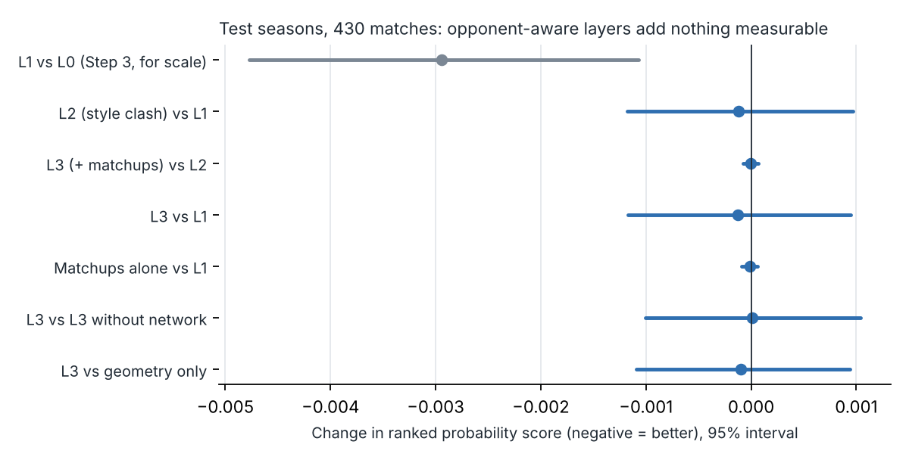
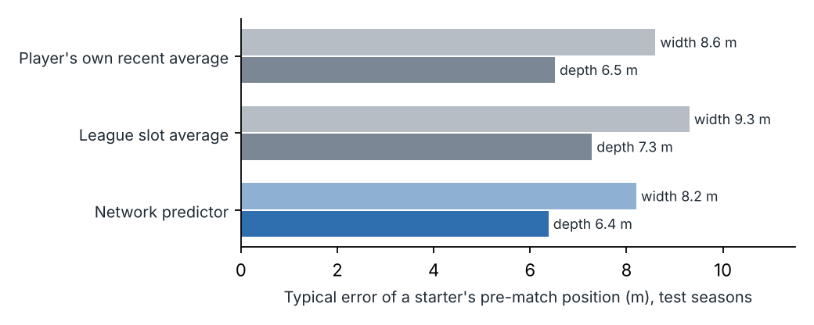

# Step 4 memo: Opponent-aware layers (L2 style clash, L3 matchups)

**Date:** 2026-10-19 · **Methodology:** v0.9 · **Code:** `opponent-aware-xi-dev` (`src/netpred.py`, `src/matchups.py`, `src/outcome.py`, `src/run_l23.py`, `src/step4_figures.py`, `tests/test_step4.py`)

## 1. In one paragraph

This was the project's central test: once the model knows both starting XIs (L1), does knowing *how the opponent plays* improve the forecast? To find out, the model now predicts each lineup's passing network before kick-off (where every starter will stand, and who will pass to whom). On top of L1 it adds two layers:

- **L2, the style clash.** It asks whether a team's style works better or worse against particular opposing styles.
- **L3, six matchup features.** For example: our wingers against their full-backs, our dribblers against their defenders, and our press against their build-up.

**Neither layer beats L1 on the test seasons.** The ranked probability score is 0.2070 for L2 and L3 against 0.2071 for L1. The 95% interval of the difference (−0.0012 to +0.0010) sits squarely on zero, and is a fraction of the gain L1 made over L0. The network ablation gives the same answer: building these features with or without the passing network makes no difference to forecasts. This is a negative finding, and per the project's rules it is reported as one. With three seasons of public data, a model that knows who starts and what those players do already captures what the data can say about a match. Opponent-specific style and matchup effects, if they exist, are too small to detect here. The passing-network work is not wasted: the network predictor places players well before kick-off, and it tells us how a lineup change reshapes a team. That is what the lineup picker's explanations will use.

## 2. What was built

- **Network predictor (`netpred.py`).**
  - **Where each starter will stand.** From team news we know the formation and the eleven names. Each player is assigned to the slot nearest his usual position, using the Hungarian method. His predicted position is his own recent average, pulled toward where his team's player in that slot usually stands.
    - The pull is two matches' worth of evidence.
    - Recent matches count most: a 120-day half-life.
    - Both settings were chosen on 2024/25.
  - **Who passes to whom.** A pass-link model predicts the passes between every pair of starters from four kinds of input:
    - the distance between them, whether a pass between them goes forward, and whether they share a line;
    - whether either is the goalkeeper;
    - each player's passing and receiving habits;
    - the team's volume and the strength gap.
  - Together these give a predicted network for any XI, including one that has never played together, and from it the Step 1 shape and structure measurements.
- **Opponent-aware features (`matchups.py`)**, for every match and both directions, all as of the match date:
  - **Style scores** of both teams (the four Step 1 dimensions).
  - **Zone mismatches.** Our attacking quality against their defensive cover in the attacking third, separately on the wings, in the half-spaces and in the centre. Their cover is weakened where they concede more chances than average.
  - **Dribble and aerial mismatches** between our five most advanced players and their five deepest, paired by position.
  - **Press against build-up.** How hard we press, against how much they build through the keeper and centre-backs.
  - **Two cut-down versions for the ablation:** one built without the passing network at all, one with its geometry only.
- **L2 and L3 in the outcome model (`outcome.py`).** The new terms enter the same stint model and pre-match forecast as L1, each held toward zero by its own penalty. L1's settings are kept.
- **Tests** (`tests/test_step4.py`), all passing:
  - predicted positions, lane vulnerability and fits use only earlier matches;
  - every XI fills ten different slots;
  - both directions of a match mirror each other;
  - a very large penalty gives back L1's forecast.

**Terms.** *Style clash:* whether, say, a direct team does unusually well against a team that builds through its keeper. *Ablation:* removing one ingredient to see whether results change. *Penalty:* how strongly a term is held toward "no effect"; tuned on 2024/25.

## 3. Decisions

| Decision | Options considered | Choice | Why |
|---|---|---|---|
| Pre-match positions | Methodology form (slot average + team shift + player offset); player's own recent average; own average pulled toward the slot | **Own average pulled toward the slot** (2 pseudo-matches, 120-day half-life; team shift 3) | Lowest error on 2024/25. On test: 6.4 m in depth and 8.2 m in width, against 6.5 / 8.6 for the own average and 7.3 / 9.3 for the slot average. The methodology form is kept for slots a player hasn't played (Step 5) |
| Pre-match slot assignment | Standardized positions (as for observed slots); positions in metres | **Metres**, against the team's own slot positions | Agrees more often with the slot later observed (62% vs 60% on 2024/25) |
| Pass-link model settings | Tune on 2024/25; fixed | **Fixed** (moderate penalties, 365-day memory, refit monthly) | It is an input, not a forecast layer; validated on its own (below) |
| Style clash form | Low-rank interaction (methodology, 4–8 parameters); all 16 products of the two teams' scores, one penalty | **All 16 products with one penalty, 1,000** | The penalty does the work of the low rank; the same family, one setting to tune |
| Style main effects | Add; leave out | **Left out** | No gain on 2024/25 (team effects already carry a team's own style) |
| Matchup settings | Penalty 30 / 300 / 3,000; zone width 6 / 10 / 15 m; vulnerability on or off | **3,000; 15 m; on** | Lowest error on 2024/25, but every setting tied within 0.5%: the features barely matter |
| Player quality in zones | L1 player effects; profile composites | **Profile composites** (shooting, creation and progression for attack; tackles, interceptions, blocks, clearances for defence) | L1's effects are only comparable within a position group; the zone sums mix groups |
| Tuning refits | Every match day; weekly | **Weekly for the tuning grid, every match day for test** | Same for every candidate, so the comparison is fair; keeps the grid to about an hour |

## 4. Results

**The ladder on the test seasons** (2025/26 + 2026/27 R1–5, 430 matches; differences with 95% intervals from resampling matches):

| Model | RPS | Log-loss | npxG error |
|---|---|---|---|
| L0: team ratings | 0.2101 | 1.036 | 0.359 |
| L1: players | 0.2071 | 1.027 | 0.355 |
| **L2: + style clash** | **0.2070** | **1.026** | **0.357** |
| **L3: + matchups** | **0.2070** | **1.026** | **0.357** |
| Market (reference) | 0.2048 | — | — |

- **L2 − L1:** RPS −0.0001 (−0.0012 to +0.0010); log-loss −0.0011 (−0.0042 to +0.0021); npxG error +0.0018 (−0.0020 to +0.0060). A tie.
- **L3 − L2:** 0.0000 on every measure (interval ±0.0001). The matchups add nothing.
- **Matchups alone on L1:** also 0.0000.
- **On the tuning season** the style clash improved the npxG forecast by 0.5% (0.3446 vs 0.3462) while making win/draw/loss slightly worse (0.1945 vs 0.1942). On test the npxG gain did not carry over.

**Network ablation (§15.3): does the passing network improve forecasts?** No.

| L3 built from | RPS | npxG error |
|---|---|---|
| Box score and team features only (no network) | 0.2070 | 0.355 |
| Network geometry only | 0.2071 | 0.356 |
| Full network | 0.2070 | 0.357 |

L3 against the no-network version: RPS 0.0000 (−0.0010 to +0.0010). All three are within noise of each other and of L1.

**How big are the effects?** The largest style-clash coefficient moves a side's npxG by under 1% per unit of each team's style score. Every matchup coefficient is 0.2% or less. For comparison, swapping an average winger for one of the best moves his team's npxG by several percent.

**The network predictor works.**

- **Positions** beat both simple alternatives on test (figure below). It assigns 63% of starters to the slot they actually end up in: defenders 77%, midfielders 54%, forwards 58%. Many misses are swaps between neighbouring slots, as in Step 1.
- **Pass links:** the model explains 31% of the variation in passes between pairs beyond the team's total volume (correlation 0.62 on test).
- **Team shape from the predicted XI** tracks the real match. It correlates 0.39–0.52 with actual centroid, line heights and pass volume, and 0.47 with goalkeeper involvement. Added to the Step 1 style forecast, it raises the share of match-to-match variation explained, for example:
  - pass volume: 29% → 37%;
  - attacking height: 13% → 21%;
  - defensive line: 15% → 21%.

  This comes from a simple fit on the test seasons themselves, so read it as a description: the lineup changes the shape, and the predictor sees it.

## 5. What it means for the model

- **The thesis, as tested, is not supported.** On three seasons of Premier League data, knowing how the opponent plays doesn't improve forecasts once both XIs and their box-score profiles are known. This is the paper's central result and is reported plainly. It doesn't show that opponent-specific tactics don't matter. It shows that these public data (average positions, full-match pass counts, about 1,100 matches) can't measure their effect on chances.
- **L1 stays the forecasting model** (approved at the checkpoint). Step 5's lineup picker chooses XIs with L1.
- **The opponent-aware features become the explanation layer.** The network predictor and the matchup features describe what a lineup change does: who faces whom, how the shape shifts, where the opponent concedes. They are labelled as descriptive, not as evidence of extra points.
- **The passing network earns its place for description, not prediction.** It predicts a lineup's shape well. It doesn't improve forecasts of results.
- **What would change the answer:** more seasons, tracking or event data with time stamps, or a narrower question (for example, set-piece aerial matchups only). These are noted for the write-up, not planned.

## 6. Questions for Benjamin (checkpoint), answered 2026-10-19

1. Which model should Step 5's lineup picker use? **L1; style and matchup features used only to explain recommendations.**
2. Should this be reported as the project's main negative finding? **Yes, plainly.**

Not done (optional in the roadmap): the manager adjustment. It is left for later.

## 7. Next step

**Step 5: Lineup picker and back-test** (methodology §10.1, §13, §14, §15.4), with L1 as the model:

- convert predicted chances into expected points;
- build the lineup optimiser, the 70% decision rule, and the explanation output (with the Step 4 features as descriptions);
- back-test 2025/26 + 2026/27 against the manager's XI and the usual XI;
- check overlap with managers' choices and the forced-change matches.

Because L1 ignores the opponent's style, the recommended XI changes with the opponent only through the opponent's strength (underdog or favourite) and its players. That makes the Step 5 back-test a test of "best XI for this match" rather than of tactical matchups.
