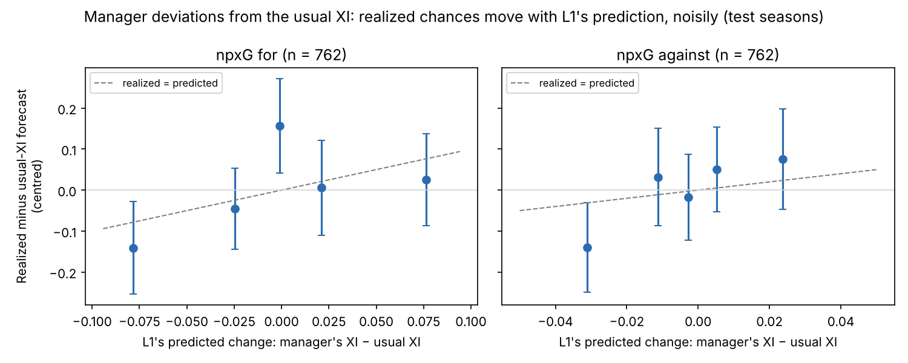

# Step 5 memo: Lineup picker and back-test

**Date:** 2026-10-20 · **Methodology:** v1.0 · **Code:** `opponent-aware-xi-dev` (`src/lineup.py`, `src/run_backtest.py`, `src/explain.py`, `src/step5_figures.py`, `tests/test_step5.py`)

## 1. In one paragraph

The model now picks lineups. For every Premier League match in the test seasons (2025/26 and 2026/27 rounds 1–5: 430 matches, 860 team selections), it asks: given the matchday squad and the opponent's actual starting XI, which XI gives this team the most expected points? It scores each candidate XI with L1, the player model from Step 3. It recommends a change from the team's usual XI only when it is more than 70% sure the change is better.

Five things came out of the back-test:

- **The picker is sensible but disagrees with managers more than they disagree with themselves.** The usual XI matches the manager's XI on 9.0 of 11 players. The recommendation matches on 8.2.
- **L1's sense of who makes a team better holds up out of sample.** When managers deviate from their usual XI, or are forced to by missing regulars, the chances their team actually creates and concedes move the way L1 predicted.
- **Knowing the opponent barely changes the pick.** This is a second null result on opponent awareness, alongside Step 4.
- **The underdog idea runs the other way.** In this model, big underdogs gain more from defenders, and favourites from attackers.
- **Many recommendations are probably not real opportunities.** They lean toward attacking players the manager has recently benched. The model can't see fitness, training or rotation, so the right reading is "the manager knows something the data doesn't".

## 2. What was built

- **Expected points for any XI (`lineup.py`).**
  - L1 predicts each side's non-penalty xG from the two starting XIs.
  - Each starter counts for his expected share of the match; the rest of his share goes to the team's average substitute.
  - Chances become goals and win/draw/loss probabilities exactly as in L1's forecasts (§10.1).
  - Expected points = 3 × P(win) + P(draw).
  - Check: for the manager's actual XI this reproduces L1's test forecasts to within 0.000004.
- **Four XIs per team selection**, all in the formation the manager named on the teamsheet:
  - **Usual XI.** The manager's habitual personnel among the available players, ignoring the opponent. Each slot goes to the available player with the most recent starts in that slot. "Recent" means a 15-day half-life, chosen on 2024/25 because it matched managers' XIs best.
  - **Best XI against an average opponent.** The highest expected points against a league-average team.
  - **Best XI against this opponent.** The highest expected points against this opponent's actual XI and strength.
  - **Recommended XI.** The best XI if P(better than the usual XI) > 0.7; otherwise the usual XI.
- **How the best XI is found.** A quick first pass ranks players by how much they add (an assignment problem, §13.2). Then the search tries every single bench-for-starter swap and keeps any that raises expected points, until none does (§13.3).
- **How sure is "70% sure"?** The model's estimates are redrawn 300 times from their statistical uncertainty. The opponent's players are redrawn too. P(better) is the share of draws in which the best XI beats the usual XI.
- **Explanation cards (`explain.py`, §14).** For each recommended swap:
  - Its own expected-points gain, split into attack and defence.
  - Then, clearly labelled as not adding expected points, the Step 4 descriptions: how the team's predicted shape changes (line heights, width), who faces whom, and where the opponent concedes chances.
- **Tests (`tests/test_step5.py`), all passing:**
  - expected points match the existing win/draw/loss code;
  - expected match shares use only earlier matches;
  - the recommendation follows the 70% rule exactly;
  - every XI fills ten different slots;
  - swaps are like-for-like.

## 3. Decisions

| Decision | Options considered | Choice | Why |
|---|---|---|---|
| Formation | Search over formations the team has used (methodology §13.1); the teamsheet's formation | **Teamsheet formation** | L1 can't judge shape: position levels aren't identified (Step 3), and the shape layers didn't help (Step 4). The picker chooses personnel within the manager's shape |
| Comparing players | Raw L1 effects; effects relative to each player's position group | **Within position group** | With raw effects the first run dropped centre-backs for attackers (Konaté → Elliott, Dunk → O'Riley). Centre-backs carry a game-state penalty (Step 3), so cross-position swaps looked like free points, with P(better) near 0.9 everywhere |
| Who can fill a slot | Any group a player has started in; primary group only | **Primary group, or the slot the manager uses him in** | The looser rule allowed chains that changed the positional mix (Haaland out, a winger moved inside). Out-of-position picks are limited to the manager's own |
| Usual XI memory | Half-life 15, 30, 60, 120, 240, 365 days, none | **15 days** | Best agreement with managers on 2024/25 (8.26 of 10 outfielders; 30 days 8.22, no decay 7.65) |
| Goalkeeper | Model choice; incumbent rule (§8) | **Incumbent** (most recent starts) | Shot-stopping didn't help forecasts (Step 3). The incumbent was the actual starter 90% of the time |
| Uncertainty for the 70% rule | Full Bayesian refit; approximation around the fitted model | **Approximation** (quasi-Poisson Laplace, 300 draws per match day) | Seconds per day. It covers estimation uncertainty only, not what the model can't see |
| Fitness filter | Only players who started or played 45+ minutes in the last three matches; none | **None; reported as a limitation** | Chosen at the checkpoint: keep the picker data-chosen and state the caveat plainly |
| Showcase fixtures | Five candidates | **A, B, C, E** (below) | Chosen at the checkpoint |

## 4. Results

**Agreement with managers (§15.4.1)**, players in common with the manager's XI (out of 11):

| XI | Mean | 9 or more | All 11 |
|---|---|---|---|
| Usual XI | 9.0 | 70% | 10% |
| Recommended XI | 8.2 | 42% | 5% |
| Best XI (no 70% rule) | 7.8 | 31% | 1% |

**How often it recommends a change.**
- The best XI differs from the usual XI in 96% of selections.
- The 70% rule keeps 65% of those as recommendations, usually 3 changes.
- The median P(better) is 0.76.

**Model-scored expected points (§15.4.3).** These are circular, because the model grades its own picks; read them as a sanity check, not evidence.
- Recommended − usual: +0.046 per match (95% interval +0.043 to +0.049), about 1.7 points over 38 matches.
- Manager's XI − usual: +0.005.
- Similar in both test seasons (+0.046 and +0.042).

**Does L1 judge lineup changes correctly?** This is the non-circular check. The yardstick is a slope: 1 means realized changes are as big as predicted, 0 means no link.

| Check | Team selections | Slope, chances created | Slope, chances conceded |
|---|---|---|---|
| Manager's XI differs from usual XI | 762 | 0.9 (0.0 to 1.8) | 3.1 (0.3 to 5.7) |
| A regular is missing from the squad (vs full-strength XI) | 448 | 1.4 (0.5 to 2.3) | 4.2 (1.7 to 6.7) |

- The direction is right: realized chances move the way L1 predicted, about as much as predicted in attack.
- In defence they move three to four times more than predicted: **L1 under-rates defensive differences between players.**
- The signal is weak match by match (correlations about 0.1), as expected when one player changes a team's chances by a few hundredths of a goal.

**Knowing the opponent.**
- The best XI against this opponent differs from the best XI against an average opponent in 8.5% of selections.
- The difference is worth 0.0001 expected points per match.
- L1 adds player effects on a multiplicative scale, so the best players are best against nearly everyone. Only the trade-off between attack and defence can shift, and it barely does.

**Underdogs and favourites (§10.1).** The value of attacking relative to defending players (g_A / g_B):

| Team's win chance | Selections | Attack / defence value |
|---|---|---|
| Below 25% (big underdog) | 172 | 0.72 |
| 25–45% | 424 | 1.05 |
| 45–65% | 237 | 1.48 |
| Above 65% (favourite) | 27 | 2.13 |

This is the opposite of the methodology's expectation that underdogs lean attacking. A player effect changes a team's chances by a percentage, and a weak team creates few chances, so a better attacker adds little in absolute terms. Meanwhile a draw is worth a point to an underdog, which defenders help secure.

**What the recommendations look like.**
- 76% of their expected-points gain comes from attacking terms.
- 58% of the players brought in started none of the team's previous three matches. The players taken out started 2.3 of 3 on average.
- These are mostly regulars returning from injury, rested stars, and creative players preferred over holding midfielders (Ødegaard for Zubimendi).

## 5. Showcase fixtures

Full cards: `reports/step5_showcase.md`.

**A. Tottenham v Arsenal, 2025/26 R27 (for Arsenal).** The biggest recommendation:
- Saka for Trossard, Ødegaard for Zubimendi, Calafiori for Hincapié, Jesus for Gyökeres: +0.175 EP, P(better) 0.98.
- The manager's XI shared 10 of 11 with the usual XI.
- The model can't see why Saka and Ødegaard weren't starting, so this is the clearest example of the limitation.

**B. Manchester United v Liverpool, 2025/26 R35 (for Liverpool).** Forced changes: Salah, Isak and Alisson were missing.
- L1 predicted the absences cost 0.23 xG of attack (−0.15 EP).
- Liverpool created 0.89 xG and conceded 2.34.
- The model's only option (Gomez for Frimpong, P 0.65) falls below the bar, so it agrees with the manager's XI.

**C. Arsenal v Manchester City, 2025/26 R5 (for City).** One of the rare cases where the opponent changes the pick:
- Against an average team the best XI has Aké; against Arsenal, Gvardiol.
- The difference is worth 0.002 EP: the opponent-awareness result in one line.

**E. Fulham v Arsenal, 2025/26 R8 (for Arsenal).** The 70% rule at work:
- The best option (Martinelli, Merino, White) is +0.030 EP but only 68% likely to be better.
- So the usual XI is recommended, and it is exactly what the manager picked.

## 6. What it means for the model

- **The picker works as a "best available XI" tool.** It knows who is better within each position, and that knowledge is confirmed on matches it never saw.
- **It is not an opponent-aware tool.** Neither the opponent's style (Step 4) nor its strength and players (this step) moves the choice by a measurable amount. For the paper this completes the central finding: with these data, the best XI is nearly the same against everyone.
- **Its main blind spot is what managers know and data don't**: fitness, training and rest. Recommendations to start a benched star should be read as questions ("why isn't he starting?"), not answers.
- **L1 under-rates defending.** A better defensive part of the player model is the clearest improvement for future work. Possible routes: a box-score prior that weighs defensive actions more, or a richer game-state term.

## 7. Questions for Benjamin (checkpoint), answered 2026-10-20

1. Which showcase fixtures? **A, B, C and E.**
2. Add a fitness filter? **No; report the limitation plainly.**

## 8. Next step

**Step 6: Write-up**:
- Update the working paper and slide deck with the full results. Step 4's negative finding is the central result, with Step 5 as its practical confirmation and these showcases.
- Release the code and processed tables to the public repo.
- Run the two robustness checks: the bootstrap by whole rounds, and a match-level L1 without stints.
