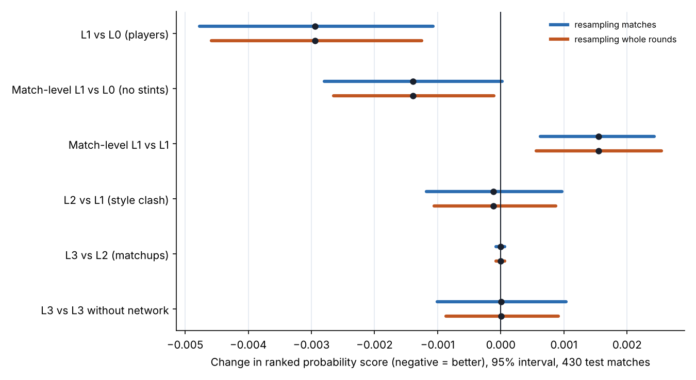

# Step 6 memo: Write-up, robustness checks and public release

**Date:** 2026-10-20 · **Methodology:** v1.1 · **Code:** `opponent-aware-xi-dev` (`src/robustness.py`, `src/step6_figures.py`, `tests/test_step6.py`; `src/run_l23.py` now also saves every variant's forecasts)

## 1. In one paragraph

The project is written up and released. Everything was rebuilt from the raw data first, and every earlier number came back exactly. Two robustness checks were run.

- **Resampling whole rounds** instead of single matches changes no conclusion. The player model (L1) still beats team ratings (L0). The opponent-aware layers still tie it.
- **Fitting the player model on whole matches** instead of stints gives up about half of its gain over team ratings. The stints were worth building. The methodology had guessed the opposite (a tie), so this is reported as a finding.

The working paper, the slide deck and the SSAC abstract now tell one story. Who plays improves forecasts. How the two teams' styles and players line up does not. The best XI is nearly the same against every opponent. The public repo holds the code and the processed tables, with no raw data.

## 2. What was built

- **Full rebuild from raw data** (Steps 0–5). Every earlier test score reproduced exactly:
  - L1 0.2071;
  - L2 and L3 0.2070;
  - every number in the lineup back-test.
- **Round-level bootstrap (`robustness.py`).**
  - Until now, model comparisons resampled single matches.
  - Matches in the same round share conditions (a midweek round after European games, a weekend of upsets), so their results may move together.
  - This check resamples the 43 test rounds instead, 5,000 times, for every comparison in the model ladder.
- **Match-level L1 (`robustness.py`).**
  - The same player model, fitted on one row per team-match: the team's npxG over the whole match, with every player who appeared counted for his share of the match.
  - Game state and red cards drop out, because they change within a match.
  - The forecast for the next match is built exactly as L1's, so the two differ only in how player effects are fitted.
  - Run twice: with L1's settings, and with settings re-chosen on 2024/25.
- **Figure** `reports/figures/step6_ladder_robustness.png`: the ladder with both kinds of interval.
- **Tests** (`tests/test_step6.py`), all passing:
  - the match-level data add up to the stints;
  - the match-level fit uses only earlier matches;
  - the round bootstrap behaves as it should on made-up data.
- **Working paper** rewritten for the final results:
  - new title, abstract, data and method sections;
  - results with the opponent-aware test as the central finding;
  - a robustness section, four showcase fixtures, discussion, limitations and conclusion;
  - four figures.
- **Slide deck** updated to 29 slides:
  - a "short answer" slide up front;
  - one data-cleaning slide in place of five;
  - layer slides marked as built;
  - seven results slides: model ladder, opponents shape style, the central null result, the picker, how much the opponent changes the pick, a showcase, robustness.
- **SSAC abstract** rewritten around the final results.
- **Public release** pushed to `Benjaminvida1/opponent-aware-xi`:
  - code, tests, reports, figures and memos;
  - 33 processed tables (38 MB);
  - no raw files; the old one-season notebook removed.
  - Rerunning L0 from the public files alone reproduces its result.

## 3. Decisions

| Decision | Options considered | Choice | Why |
|---|---|---|---|
| What a "round" is in the bootstrap | Official round; match week by date | **Season × official round** (43 in the test period) | Matches in a round are scheduled together; rescheduled games are few |
| Match-level L1: who counts | Starters only; everyone who played | **Everyone who played, weighted by share of the match** | The same players the stint model sees, without the stint structure |
| Match-level L1: settings | L1's; re-chosen on 2024/25 | **Both reported** | L1's settings ask "do stints matter, everything else equal"; re-tuning makes sure the match-level version isn't handicapped. The best re-tuned setting sat on the grid's edge, so the grid was extended (as in Step 3) |
| Paper title | Keep "A Framework and Early Evidence"; new | **"…: Evidence from Four Premier League Seasons"** | The old title described a paper with no results yet |
| Deck: old one-season results slides | Update each; replace | **Replace with seven new results slides; merge five data slides into one** | The talk now leads with the answer; data engineering is background |
| Public release contents | Everything processed; leave out odds and player attributes | **Everything processed** (chosen at the checkpoint) | Every reported result, including the market comparison, can be rerun |
| SSAC abstract | Leave; update | **Update** (chosen at the checkpoint) | It still had the September one-season numbers |

## 4. Results

**Round-level bootstrap.** Intervals from resampling rounds are 0.82 to 1.17 times as wide as from resampling matches. Every verdict holds.

| Comparison | Difference in RPS | 95% range, matches | 95% range, rounds |
|---|---|---|---|
| L1 vs L0 (players) | −0.0029 | −0.0048 to −0.0011 | −0.0046 to −0.0013 |
| L2 vs L1 (style clash) | −0.0001 | −0.0012 to +0.0010 | −0.0011 to +0.0009 |
| L3 vs L2 (matchups) | 0.0000 | −0.0001 to +0.0001 | −0.0001 to +0.0001 |
| L3 vs L3 without network | 0.0000 | −0.0010 to +0.0010 | −0.0009 to +0.0009 |
| L0 vs market | +0.0053 | 0.0000 to +0.0105 | −0.0002 to +0.0106 |

The only change is at the edge: L0's gap to the betting market now includes zero.

**Player model on whole matches instead of stints.**

| Model | RPS | Share of the gap from base rates to the market |
|---|---|---|
| L0: team ratings | 0.2101 | 77% |
| Match-level L1, L1's settings | 0.2087 | 83% |
| Match-level L1, re-chosen settings | 0.2082 | 85% |
| L1 on stints | 0.2071 | 90% |

- With L1's settings, dropping the stints costs **0.0015** (range +0.0006 to +0.0024; by rounds +0.0006 to +0.0025), about half of L1's gain.
- With re-chosen settings the cost is 0.0011 (range −0.0002 to +0.0023), just short of clear.
- The match-level model still beats team ratings, narrowly (−0.0014; by rounds −0.0026 to −0.0001).

Two caveats:

- On the tuning season the two versions were level.
- The gap shows in results, not in total chances: npxG deviance ties (+0.0004, range −0.0020 to +0.0029).

The likely reason is what stints control for. A player is credited only for chances while he is on the pitch, at the score and man count he faced.

## 5. What it means for the model

- **The main findings are not an artefact of how the test was resampled.** The player model's gain and the opponent-aware null both survive the stricter test.
- **The stint model was worth its cost.** A simpler match-level model keeps only half the gain. Future versions should keep stints.
- **The project's answer is now final for these data:**
  - players matter;
  - opponent styles and matchups add nothing detectable;
  - the picker is a "best available XI" tool whose blind spot is managers' private information.

## 6. Questions for Benjamin (checkpoint), answered 2026-10-20

1. Push the public release with all processed tables, including odds and player attributes? **Yes, as prepared.**
2. Update the SSAC abstract to the final results? **Yes.**

## 7. Next step

The roadmap is complete. The deferred items stay in the roadmap's list:

- opponent-XI prediction;
- GBM benchmark;
- simulator;
- manager adjustment;
- goalkeeper shot-stopping;
- physical data.

The clearest model improvements, if work continues:

- a better defensive model of players;
- a fitness and availability layer.
